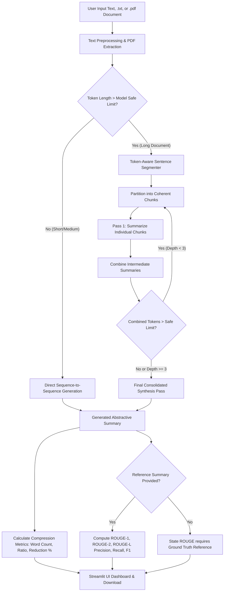

# Automatic Text Summarization Using Transformer-Based Models and LLMs
### Academic NLP Case Study & Interactive Demonstration System


---

## 📖 Executive Summary & Abstract
Automatic text summarization is a cornerstone problem in Natural Language Processing (NLP). With the rapid proliferation of digital documents, extracting concise and semantically accurate digests without losing salient information is essential. 

Historically, summarization was solved via **extractive** techniques—selecting preexisting sentences based on graph centrality (TextRank) or statistical word frequencies (TF-IDF). While factually faithful, extractive summaries lack narrative cohesion, produce disjointed sentences, and cannot condense multi-sentence concepts into concise phrases.

This project implements an **academic NLP study and interactive studio** for **abstractive text summarization**, leveraging:
1. **BART (`facebook/bart-large-cnn`)**: An encoder-decoder denoising autoencoder fine-tuned for abstractive news summarization.
2. **FLAN-T5 (`google/flan-t5-base`)**: An instruction-tuned Text-to-Text Transfer Transformer model.
3. **Local Large Language Models (LLMs via Ollama)**: Local zero-shot abstractive summarization requiring zero API keys.
4. **Document Ingestion**: Seamless ingestion of plain text (`.txt`) and PDF documents (`.pdf` via `pypdf`) with encryption detection, corrupted file recovery, and scanned/empty PDF validation.
5. **Recursive Hierarchical Chunking**: A token-budget-aware segmentation pipeline allowing documents of arbitrary length to be summarized without input truncation or infinite loops.
6. **Empirical ROUGE Evaluation**: Ground-truth benchmarking assessing unigram recall (ROUGE-1), bigram fluency (ROUGE-2), and longest common subsequence structure (ROUGE-L).

---

## 🏛️ System Architecture

The following diagram illustrates the complete processing and summarization pipeline:



---

## 🔬 Model Technical Deep-Dive

### 1. BART (`facebook/bart-large-cnn`)
* **Architecture**: Bidirectional encoder (similar to BERT) coupled with an autoregressive left-to-right decoder (similar to GPT). Contains ~406 million parameters.
* **Pretraining Strategy**: Trained as a **denoising autoencoder**. The training text was deliberately corrupted using arbitrary noise transformations:
  - *Token Masking*: Random words replaced with `[MASK]`.
  - *Token Deletion*: Random words dropped from the input.
  - *Text Infilling*: Spans of text replaced with a single mask token.
  - *Sentence Permutation*: Document sentences shuffled randomly.
  - *Document Rotation*: Random tokens chosen as document start.
* **Fine-Tuning**: Fine-tuned on the CNN/DailyMail dataset (287,000 journalism article-summary pairs), making it specialized in narrative flow and journalistic conciseness.
* **Input Context Window**: 1,024 tokens.

### 2. FLAN-T5 (`google/flan-t5-base`)
* **Architecture**: Standard encoder-decoder Transformer with ~250 million parameters.
* **Pretraining & Instruction Tuning**: Pretrained on C4 (Colossal Clean Crawled Corpus) using span corruption, followed by **instruction tuning** across 1,836 NLP tasks formulated as natural language instructions.
* **Task Conditioning**: Requires explicit prompt conditioning (`"summarize: <text>"`).
* **Input Context Window**: 512 tokens. Parameter-efficient, highly responsive to prompt phrasing.

### 3. Local LLM Integration (Ollama)
* **Architecture**: Decoder-only autoregressive LLM (e.g., Llama 3, Mistral 7B, Gemma).
* **Integration**: Communicates via local REST API at `http://localhost:11434/api/generate`.
* **Zero Cost & Offline**: Operates completely offline on local compute with no cloud dependencies or API subscription keys.

---

## 📏 Evaluation Metrics: Mathematical Foundations

ROUGE (Recall-Oriented Understudy for Gisting Evaluation) calculates n-gram co-occurrence between the candidate summary ($C$) and the reference summary ($R$):

### 1. ROUGE-N (Unigram & Bigram Overlap)
$$\text{Recall}_{\text{ROUGE-N}} = \frac{\sum_{S \in \{R\}} \sum_{\text{gram}_n \in S} \text{Count}_{\text{match}}(\text{gram}_n)}{\sum_{S \in \{R\}} \sum_{\text{gram}_n \in S} \text{Count}(\text{gram}_n)}$$

$$\text{Precision}_{\text{ROUGE-N}} = \frac{\sum_{S \in \{C\}} \sum_{\text{gram}_n \in S} \text{Count}_{\text{match}}(\text{gram}_n)}{\sum_{S \in \{C\}} \sum_{\text{gram}_n \in S} \text{Count}(\text{gram}_n)}$$

$$\text{F1}_{\text{ROUGE-N}} = \frac{2 \times \text{Precision} \times \text{Recall}}{\text{Precision} + \text{Recall}}$$

- **ROUGE-1**: Evaluates unigrams ($n=1$). Measures overall informational coverage.
- **ROUGE-2**: Evaluates bigrams ($n=2$). Measures local syntactic fluency and adjacent phrase capture.

### 2. ROUGE-L (Longest Common Subsequence)
$$\text{ROUGE-L}_{\text{Recall}} = \frac{\text{LCS}(C, R)}{|R|}, \quad \text{ROUGE-L}_{\text{Precision}} = \frac{\text{LCS}(C, R)}{|C|}$$
Identifies the longest in-sequence common words without requiring them to be consecutive, reflecting sentence structure fidelity.

> [!IMPORTANT]
> **Academic Note on Ground Truth**: ROUGE cannot be computed without an authoritative human reference summary. The application explicitly explains this constraint and does not fabricate scores when reference summaries are absent.

---

## 🛠️ Project Structure

```text
CASESTUDY/
│
├── app.py                     # Streamlit interactive dashboard & visualization
├── requirements.txt           # Python package requirements
├── README.md                  # Project documentation & academic report
├── .gitignore                 # Version control ignore configuration
│
├── src/                       # Modular source code
│   ├── __init__.py
│   ├── summarizer.py          # BART, FLAN-T5, chunking, hierarchical logic, Ollama
│   └── evaluation.py          # ROUGE metrics, comparison tables, benchmarking
│
└── tests/                     # Automated unit and integration tests
    ├── __init__.py
    └── test_summarizer.py     # Preprocessing, chunking, compression, ROUGE tests
```

---

## 🚀 Setup & Execution Guide

### Prerequisites
- Python 3.10 or 3.11
- 4GB+ RAM (8GB+ recommended for BART model weights)
- Git

### 1. Clone the Repository
```bash
git clone https://github.com/gayathris3884-coder/automatic-text-summarization.git
cd automatic-text-summarization
```

### 2. Install Dependencies
```bash
# In your Python virtual environment (e.g. py311 or venv):
pip install -r requirements.txt
```

### 3. Run Automated Unit Tests
```bash
pytest tests/test_summarizer.py -v
```

### 4. Launch the Streamlit Web Application
```bash
streamlit run app.py
```
Open your browser at: **`http://localhost:8501`**

---

## ⚠️ Limitations & Ethical Considerations
1. **Factual Inconsistency / Hallucination**: Abstractive seq2seq models generate text probabilistically. While rare in models fine-tuned on CNN/DailyMail, hallucinations can occur if the source document contains unusual domain terminology.
2. **Context Limits**: Although hierarchical chunking prevents crash failures on long texts, summarizing chunks separately can dilute very long-range narrative relationships.
3. **Computational Latency on CPU**: Running BART-large on CPU requires approximately 3 to 10 seconds per chunk depending on host processor clock speed.

---

## 🎓 Academic Viva Voce (Oral Defense) Preparation Guide

### Q1: What is the difference between Extractive and Abstractive Summarization?
**Answer:** Extractive summarization selects verbatim sentences directly from the source text based on sentence scoring (e.g., TextRank, TF-IDF). Abstractive summarization builds an internal semantic representation using sequence-to-sequence neural networks, then synthesizes novel phrasing and sentence constructions to compress ideas—similar to how a human summarizes.

### Q2: Why are Transformers superior to RNNs / LSTMs for text summarization?
**Answer:** Recurrent models process text word-by-word sequentially. Over long contexts, gradients vanish or explode, and computing the $t$-th step requires waiting for step $t-1$, preventing GPU parallelization. Transformers use multi-head self-attention, computing pairwise word relationships across the entire sequence simultaneously in $\mathcal{O}(1)$ sequential steps.

### Q3: How does BART's architecture and pretraining work?
**Answer:** BART is a standard sequence-to-sequence encoder-decoder model. The encoder is bidirectional, and the decoder is autoregressive with attention back into the encoder representations. BART is pretrained as a denoising autoencoder: documents are corrupted (random masking, deletion, sentence shuffling), and the network is trained to maximize the log-likelihood of reconstructing the original clean document.

### Q4: Why does FLAN-T5 require the prefix `"summarize: "`?
**Answer:** FLAN-T5 is a Text-to-Text Transfer Transformer trained on a multi-task dataset spanning translation, summarization, question answering, and logical reasoning. The prefix `"summarize: "` acts as a task indicator, guiding the attention weights toward text compression rather than language translation or classification.

### Q5: How does your system prevent Out-of-Memory (OOM) errors and infinite loops on long documents?
**Answer:** We implement **Recursive Hierarchical Summarization**:
1. Documents exceeding the token budget (750 tokens for BART, 380 for FLAN-T5) are split at natural sentence boundaries into token-bounded chunks.
2. Each chunk is summarized independently.
3. Intermediate summaries are pooled and checked. If they still exceed the budget, the process recurses.
4. An explicit recursion guard (`max_depth = 3`) halts any recursive cycling.
5. A final consolidation pass produces a unified, cohesive summary.

### Q6: Can ROUGE be evaluated without a ground-truth reference summary?
**Answer:** No. ROUGE measures the recall and precision of $n$-gram co-occurrences against a known reference summary. Without a reference, there is no target text to compare against. To evaluate summaries without a reference, one must rely on reference-free metrics such as semantic cosine similarity with the source text or LLM-based evaluation.

### Q7: What are ROUGE-1, ROUGE-2, and ROUGE-L?
**Answer:**
- **ROUGE-1**: Unigram overlap; measures topical coverage and key noun/verb presence.
- **ROUGE-2**: Bigram overlap; measures syntactic fluency and two-word phrase preservation.
- **ROUGE-L**: Longest Common Subsequence; evaluates structural order and sentence structure without demanding strict consecutive word matches.

### Q8: What role does Beam Search play in summary generation?
**Answer:** Greedy decoding picks the single highest-probability token at each step, which often leads to suboptimal text. Beam search maintains the top $K$ most likely partial sequences (hypotheses) at each step, pruning lower-probability paths. This ensures globally higher-probability sentences and avoids repetitive loops.

### Q9: What is length penalty and why is it used?
**Answer:** Autoregressive models compute sequence probability as the product of token probabilities. Because each token probability is $\le 1$, longer sequences naturally receive lower total scores. Length penalty ($\alpha$) normalizes scores by sequence length: $S(Y|X) / (|Y|)^\alpha$. Values of $\alpha > 1.0$ encourage more detailed summaries; values $< 1.0$ force stricter conciseness.

### Q10: How does Ollama enable LLM summarization without API keys?
**Answer:** Ollama runs optimized quantized open-weights models (using `llama.cpp` and GGUF quantization) locally as a background service on the host system. It exposes a local HTTP REST API at `localhost:11434`. By interacting with this endpoint, the application performs inference on local hardware without sending data to external cloud services and without paying for API keys.
